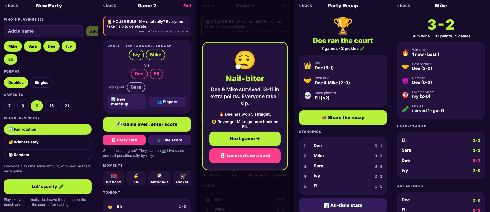

# 🥒 PickleParty

**Keep score. Cause chaos. Don't get pickled.**

PickleParty is a pickleball scorekeeper crossed with a party game. You keep score
with one tap per rally, and the app turns big moments (side-outs, game point, a
shutout "pickle", 4-point streaks, net balls, ernes) into dares, house rules and,
for players 21+, drinking-game penalties.

Built with Expo (React Native + TypeScript), so the same code ships to iOS, Android and the web.



## Features

- **Real pickleball scoring.** Classic side-out doubles (`0-0-2` start, server 1/2), singles, or rally scoring. Play to 7, 11, 15 or 21, win by 2. Undo any tap.
- **Party engine.** Match events trigger prompts automatically: Game Point, Tied, 🔥 heaters, 👀 Pickle Watch, 🥒 **PICKLED!** (an 11-0 shutout), plus one-tap moments (net ball, ace, kitchen fault, erne/ATP, 10+ rally, body shot, way out). A moment ends the rally, so it also scores it: a net ball or fault gives the rally to the other team, an ace or winner to the team that hit it.
- **Announcer.** Cartoon sound effects (air horn on a PICKLED!, wobbly sad trombone on a net ball, clown honk on a kitchen fault, bonk on a body shot, slide whistle when a ball is launched, kazoo fanfare on a win) and a voice that reads out the penalty by team name. Pick a personality: 🐿️ Squeaky Pickle (the default), 🥒 Big Dill (a posh British gentleman: the app picks a British male voice installed on the phone, or deepens the default one) or 📢 Classic. Squeaky Pickle is the kid who's had too much juice: it shouts everything, says the headline twice and signs off with "I'm telling!" or "Are we there yet?". Big Dill never raises his voice, asks you to *kindly* take your penalty and adds "I've seen better footwork from a garden gnome." Both throw in the odd pickle pun ("Brine time!"), and tapping one on the home screen plays its own introduction. Squeaky Pickle and Big Dill are Pro, and everyone gets them during the free trial; after that free players hear Classic, and their pick comes back if they subscribe. **Score calls:** after every rally the announcer calls the score the way players do before serving (serving team first, then the server number: "four, two, one"; the game opens with "zero, zero, start"). It names the serving team only when the serve changes hands ("Side out! Dink Floyd serving", "Second server"), says it last, after any penalty, so it's what players hear as they walk back to serve, and repeats the corrected score after an Undo. Switch it off with 🔢 on the home screen. Party Card dares go to the team that just lost a rally. Mute from the match screen (🔊) or the home screen. Every sound and line is original: the sounds are generated by `scripts/make_sounds.py`, the personalities live in `src/audio/personas.ts`.
- **Easy pace.** Prompts ask for 1 sip at a time (2 for big moments). Ties only count from late in the game, side-outs only sometimes, and every second game is followed by a 💧 water break. An evenly matched game to 11 works out to about 4 sips per player from the automatic prompts. The numbers live in `src/game/party.ts` (`SIDE_OUT_CHANCE`, `lateTie`, `waterBreakDue`).
- **Built for the court.** The screen stays on during a match (no unlocking between rallies). Everyday prompts appear as a banner that fades once the announcer has read it and never blocks scoring; only cards and game-ending moments take over the screen. ☀️ Sunlight mode switches the match screen to pure black with brighter, bigger text for playing outdoors. Setup suggests a **Hype Man** (someone sitting out runs the phone) and a Bluetooth speaker, and Round Robin names a Hype Man from the players sitting out each round.
- **Between games.** The game-over screen shows a result card (winner, score, PICKLED! badge) that shares to the group chat as an image. 🎡 **Spin the Loser's Wheel** lands on a fate for the losing team: carry the winners' paddles, an off-hand serve, a victory dance for the winners, a lucky escape, sips… (`LOSERS_WHEEL` in `src/game/party.ts`).
- **Party pace.** 🎉 Full party calls out side-outs, streaks and ties; 😌 Calm only interrupts for Pickle Watch, game point and the win, for groups with nobody near the phone.
- **House Rules.** Each game starts with a random rule card ("Nobody can say *out*, say *pickle*"). Tap it for a different one.
- **Spice levels.**
  - 🧃 **Chill**: no alcohol at all. Penalties become squats, planks and water. Anyone can play.
  - 🍺 **Tipsy**: sips, and a Pickle Penalty for getting shut out. Unlocked only after the 21+ age gate.
  - 🔥 **Wild** (couples only, 21+): every penalty is a drink plus a flirty act with your own partner ("take 1 sip, then give your partner a 5-second kiss"). Choosing it asks everyone to opt in, teams get couple names, and every prompt reminds players they can skip an act. Acts live in `WILD_ACTS` in `src/game/spice.ts`.
- **Party Deck.** Dares, trick shots, house rules and group votes, playable anytime (on or off the court).
- **Stats.** Win/loss rankings by team name, with a count of pickles, saved on the device. Tap a game to see it or delete it (a test game, or one scored by mistake); *Clear all games* asks first. Every delete can be undone until you leave the screen.
- **Built for sharing.** You can share any result ("…and PICKLED them 🥒💀") or any card straight to the group chat.

### PickleParty Pro (subscription or lifetime)

- ⚔️ **Crew Stats:** head-to-head rivalries, win streaks, Hall of Shame.
- 📜 **Unlimited history.** Free players keep every game, but only the latest 10 are visible.
- 📣 **Recap cards:** a weekly brag sheet to post in the group chat.
- 🏟️ **Round Robin:** runs open play for a crowd. Add everyone's name, pick courts and game length, and each round pairs up new partners with fair sit-outs. Tap **▶ Score it with PickleParty** on a court to play that game with the full party scorer (the pair names are filled in, e.g. "Sam & Alex"), and the result goes back into the standings automatically. Or just tap the winning pair. Latecomers can join between rounds, and the session is saved on the phone until you end it.
- 🃏 **Every Party Pack:** *Kitchen Nightmares*, *Trick Shot Tour*, *After Dark*, *Date Night*, seasonal packs like 🎃 *Halloween Bash*, and future drops.
- ✏️ **Custom cards:** your crew's inside jokes, shuffled into the deck.
- 🐿️ **Announcer voices:** Squeaky Pickle and Big Dill. Classic stays free.

💋 **Date Night** (21+ only) is a couples pack. Every dare involves only your own partner, everyone has to opt in each time it's switched on, and any card can be passed.

## Run it

```bash
npm install
npm start            # scan the QR code with the Expo Go app on your phone
npm run web          # or play it in a browser
npm test             # unit tests for game + business logic
npm run typecheck
npm run lint
```

## Project layout

```
src/app/                       screens (Expo Router: one file per route)
src/screens/                   screen UI
src/game/scoring.ts            pickleball scoring engine (tested)
src/game/party.ts              match events → party prompts (tested)
src/game/cards.ts              card packs: add new cards here
src/game/crew.ts               rivalries, streaks, recaps (tested)
src/game/roundRobin.ts         open-play scheduler (tested)
src/monetization/entitlements.ts  who gets what: trial, Pro, free limits (tested)
src/purchases.ts               payments via RevenueCat, plus the waitlist
src/config.ts                  links, payment keys, product ids
public/                        privacy policy, terms, waitlist form (served on the website)
```

Seasonal packs: give a pack a `season` (badge + months) in `PACKS` and it gets a "limited time" badge and a home-screen banner in those months. 🎃 *Halloween Bash* runs in October; when it's in the deck, random team names turn spooky ("The Dink Dead", "Boo Crew").

Adding content is easy: append strings to `CARDS` in `src/game/cards.ts`. Use `{sips:N}`
for a penalty and `{finish}` for the big one. Chill mode rewrites both automatically,
and a test checks that chill mode never mentions alcohol.

## Shipping to the App Store

1. Create an Apple Developer account ($99/yr) and a Google Play account ($25 one-time).
2. `npx eas-cli@latest login`, then `npx eas-cli@latest build --platform ios --profile production`.
3. `npx eas-cli@latest submit --platform ios`. Bundle id is `app.pickleparty` (change it in `app.json` if it's taken).
4. **Age rating:** answer *"Frequent/Intense Alcohol, Tobacco, or Drug Use or References"* honestly. Drinking games are typically rated **17+** on iOS. The app already includes an age gate, a responsible-play notice, and an alcohol-free Chill mode.
5. The app icon, splash, Android icons, favicon and in-app logo are all generated from the PickleParty logo in `assets/brand/logo-source.png` by `python3 scripts/make_icons.py`. To change the logo, replace that file and rerun the script. Keep `APP_LINK` in `src/config.ts` pointing at a page that links to the store, so shared results bring people back.

## Monetization

### The model

| | Free | Pro ($4.99/mo, $29.99/yr or $39.99 once) |
| --- | --- | --- |
| Scorekeeping, party prompts, Classic deck | ✅ forever | ✅ |
| Game history | latest 10 visible (all saved) | everything |
| Crew Stats, recaps, Round Robin, custom cards, Squeaky Pickle & Big Dill voices | sample/locked | ✅ |
| Premium packs | buy one at a time ($2.99, Date Night $3.99) | all included |

- **The free part stays free.** Scoring and the basic party game are how the app spreads, so they're never limited.
- **14-day reverse trial.** Every new player gets full Pro on day one with no card. When it ends, they keep playing free but lose the crew stats they got used to. That loss is the main reason to subscribe. The app shows one paywall when the trial ends and never interrupts again.
- **Sneak peeks.** Free players sometimes draw a real card from a locked pack, mid-party, when they're most likely to want more.
- **Lifetime Pro ($39.99 once)** is for crews who play a few times a month and won't subscribe to a party game. It also makes the yearly plan look like the better deal.
- **One phone runs the game,** so one organizer's subscription covers their whole crew at their matches.

### Before payments are live: the waitlist

With no payment keys set, the paywall says "Pro is launching soon" and collects emails.
That shows whether people actually want Pro before you pay Apple $99.

- Emails are saved by **Netlify Forms**. In Netlify, open your site → **Forms** → **Enable form detection**, then redeploy.
- Sign-ups appear under **Forms → pro-waitlist**, along with which locked feature people tapped (`interest`). That tells you which feature sells.

### Turning on real payments

`src/purchases.ts` uses [RevenueCat](https://www.revenuecat.com) (free to start; it takes a small cut once revenue grows), which handles Apple, Google and web payments.

1. In **App Store Connect**, create:
   - a subscription group with `pickleparty.pro.monthly` ($4.99) and `pickleparty.pro.annual` ($29.99)
   - a non-consumable in-app purchase `pickleparty.pro.lifetime` ($39.99)
   - non-consumable in-app purchases `pickleparty.pack.kitchen`, `.trickshots`, `.afterdark`, `.halloween` ($2.99) and `.datenight` ($3.99)
2. In **RevenueCat**:
   - add the app and import those products
   - create an entitlement named **`pro`** and attach both subscriptions and the lifetime product
   - make the default offering with **Monthly**, **Annual** and **Lifetime** packages
   - make a second offering called **`packs`** with one package per pack, named exactly `kitchen`, `trickshots`, `afterdark`, `chaos`, `halloween`, `datenight`
3. Put the RevenueCat public keys in EAS (and Netlify, for web payments through Stripe) as environment variables:
   `EXPO_PUBLIC_REVENUECAT_IOS_KEY`, `EXPO_PUBLIC_REVENUECAT_ANDROID_KEY`, `EXPO_PUBLIC_REVENUECAT_WEB_KEY`.
4. Build with `npx eas-cli@latest build --profile preview` and test with a Sandbox account. Purchases don't work in Expo Go; there, RevenueCat runs in a preview mode.

The paywall then shows real store prices, a plan picker, restore, and the auto-renew wording plus Terms and Privacy links that Apple requires. Both pages are in `public/` and are served at `/terms.html` and `/privacy.html`. They are starting templates, not legal advice; review them before launch.

Development builds show a **"DEV: turn Pro on/off"** button on the paywall so you can test both experiences.

### Other revenue later

| Stream | Notes |
| --- | --- |
| **Venue / league edition** | Pickleball bars and clubs: branded decks, leaderboards, round robins for their leagues. |
| **Sponsored packs** | Paddle or drink brands sponsor a themed deck. |
| **Merch** | "I got PICKLED 🥒" shirts via print-on-demand. |

## Growth playbook

- The share text on every result is what spreads the app. Every pickled game is a brag that links back to the store.
- Post short TikTok/Reels clips of the PICKLED! screen and of trick-shot card attempts. Pickleball content does very well on short-form video.
- Seed it with local clubs, rec leagues and pickleball bars, and give league organizers free Pro.
- Ideas for next versions: a camera "trick shot cam" for recording card attempts, shareable result images, online leaderboards across friends, and a tournament bracket mode.

## Play responsibly

Drinking modes are for adults of legal drinking age only. Chill mode is always available. Never drink and drive.
